# UI state machine

Source of truth: `src/domain/cardLifecycle.ts` (tests: `src/domain/cardLifecycle.test.ts`).

## Answer card lifecycle

```mermaid
stateDiagram-v2
    [*] --> pending: question.detected (new questionId)
    pending --> pending: question.revised (question text updated)
    pending --> streaming: answer.started / first delta (implicit start)
    streaming --> streaming: answer.delta (same requestId, next seq)
    streaming --> streaming: answer.started (new requestId — supersedes, explicit policy)
    streaming --> streaming: question.revised (question text updated; Rust restarts the answer)
    streaming --> completed: answer.completed
    streaming --> failed: answer.failed
    failed --> streaming: answer.started (new requestId — retry)
    completed --> streaming: answer.started after a question.revised (restart, adopts the revision)
    completed --> [*]
```

| State       | Meaning                                  | Accepted events                                                                               |
| ----------- | ---------------------------------------- | --------------------------------------------------------------------------------------------- |
| `pending`   | Question detected, no generation started | `question.revised` (updates text), `answer.started`, implicit start via first `answer.delta`  |
| `streaming` | Tokens arriving for `requestId`          | deltas/completed/failed for the **current** `requestId`; a new `answer.started` supersedes it |
| `completed` | Final answer                             | `question.revised` (recorded as a correction); then `answer.started` only (restart)           |
| `failed`    | Generation failed; partial answer kept   | new `answer.started` (retry)                                                                  |

### Rules

1. **New question** → new card, `pending`. Never mutates any other card. A duplicate
   `question.detected` for an existing `questionId` is ignored (`duplicate-question`).
2. **Streaming** → append only to the card with the same `questionId` **and** current `requestId`.
   `seq` < expected or already buffered → `duplicate-delta`; `seq` > expected → buffered and
   flushed in order.
3. **Completed** → terminal. Late deltas → `already-terminal`. A new generation cannot overwrite a
   completed answer, except a restart after a revision (rule 4).
4. **Revised transcript** → updates the question while `pending` or `streaming`. Once the answer
   has ended, the revision is appended to `questionRevisions` (a correction note). Rust writes
   the answer again for every revision, the rest of a question cut by a pause or the
   interviewer narrowing it: the new `answer.started` adopts the latest revision as the
   question and clears the note.
5. **Follow-up** → new card with `contextRef` = earlier `questionId`; the referenced card is never
   modified. The UI shows “Suite de : …”.
6. **Concurrent generations** → independent cards. A new question never cancels another
   generation. Only an explicit `answer.started` with a new `requestId` for the **same** question
   supersedes its previous request (used for retries).
7. **Failure** → card stays, partial answer kept and flagged incomplete, retry button when
   `retryable`. Late events from the failed request are rejected (`stale-request`).

Ignored events never throw; the store counts them per reason (`diagnostics.ignored`,
`diagnostics.lastIgnored`) and malformed payloads separately (`diagnostics.invalid`).

## Active question vs. history (PRD §6.5)

- `store.active` is a **copy** of the latest detected question (`questionId`, text, intent,
  language). It is updated on `question.detected`, and on `question.revised` while that question
  is still pending.
- The active panel's phase label is derived from the card with the same `questionId`.
- History cards are separate objects; nothing in the active panel can mutate a card.

## Scroll policy (`useStickyScroll`)

- The list is **pinned** when the reader is within 32 px of the edge where new cards appear
  (bottom for “Récentes en bas”, top for “Récentes en haut”).
- Pinned → follows new cards and streaming growth (ResizeObserver).
- Not pinned → the position is never changed; new cards increment an “N nouvelle(s) réponse(s)”
  pill that jumps back to the edge.
- Content inserted or growing above the viewport is compensated by native scroll anchoring
  (`overflow-anchor`, Chromium/WebView2).
- Cards use stable keys (`card.id`), never array indexes, so DOM nodes and component instances
  survive reordering and insertion (verified by tests).

## Overlay layers and modes

- **Newest question only** (« Afficher seulement la dernière question », on by default): the
  history shows only the newest card; a new question replaces the previous one on screen. The
  older cards stay in the store, so a follow-up still shows « Suite de : … ». Turned off, the
  list shows every card in the chosen order.
- **Settings sheet** and **focus view** (enlarged answer) are mutually exclusive; opening one
  closes the other. `Esc` closes whichever is open. In the text field, the first `Esc` clears a
  draft; on an empty field it closes the open layer.
- **Compact mode** hides the history and shows the active question with its card; the native
  window shrinks to 300 logical px from its top edge (position unchanged) and restores the
  previous height when expanded.

## Session status

`idle` → `listening` ⇄ `paused` → `idle` (stop), plus `reconnecting` and `error` reserved for the
real pipeline. Stop ends detection but lets in-flight answers finish; clearing the history
cancels every in-flight generation first.
